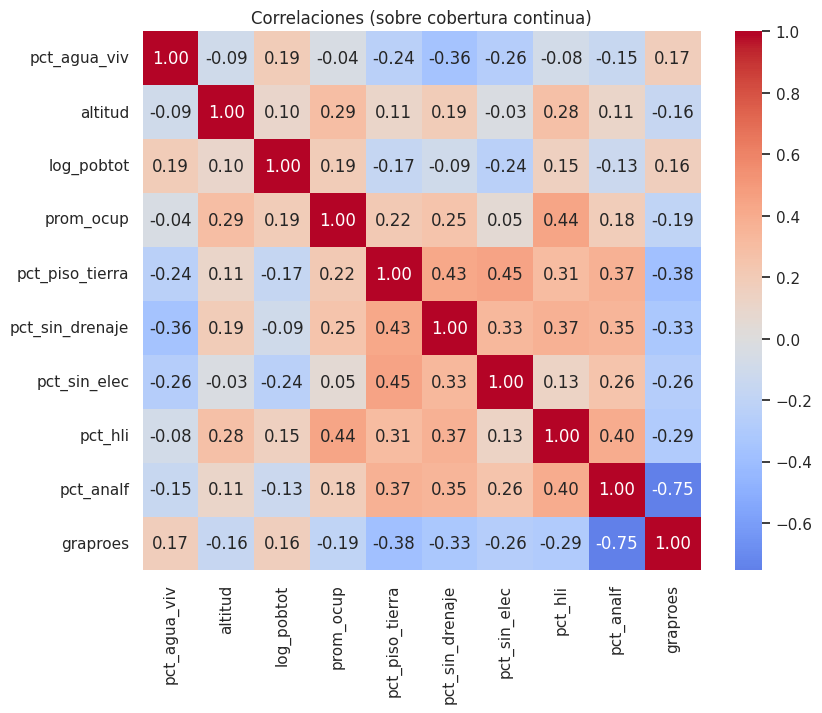

# 💧 Modelado Predictivo de Vulnerabilidad Hídrica Relativa en Chiapas, México
**Proyecto Final - Bootcamp Data Science II: Machine Learning para la Ciencia de Datos, CoderHouse**  
**Autor:** Santiago Díaz

---

## 📌 1. Presentación del Proyecto & Abstract
Este proyecto implementa un pipeline de Machine Learning supervisado para identificar y priorizar localidades rurales en Chiapas con **vulnerabilidad hídrica relativa**, definida como aquellas comunidades cuya cobertura de agua entubada en la vivienda se encuentra por debajo de la mediana estatal. 

### 🎯 Motivación y Audiencia
En México, el estado de Chiapas alberga más de 21,000 localidades según el Censo 2020 (INEGI). Monitorear el acceso al agua mediante censos comunitarios tradicionales en territorio es, logística y financieramente, muy dificultoso. Este modelo busca actuar como una herramienta de **Auditoría Territorial Inteligente**, permitiendo transitar de una toma de decisiones intuitiva o por proximidad geográfica, a una estrategia basada en evidencia censal reproducible, optimizando los recursos e intervenciones en infraestructura de salud pública.

---

## 2. Arquitectura del Pipeline Técnico

1. **Ingesta e Idempotencia (DuckDB):** Conexión directa y carga de la base de datos cruda del ITER 2020 (INEGI) de Chiapas (21,487 filas y 286 columnas) utilizando DuckDB en memoria. El pipeline garantiza idempotencia mediante sentencias `CREATE OR REPLACE TABLE`.
2. **Data Wrangling & Tratamiento de Calidad:** 
   * Filtrado de 330 registros agregados (totales municipales y estatales).
   * Conversión de coordenadas de formato DMS (Grados, Minutos, Segundos) a grados decimales puros con signo negativo para el Hemisferio Oeste.
   * Gestión del Secreto Estadístico del INEGI: Exclusión justificada de localidades con datos suprimidos (`*`), resguardando la integridad del target sin fabricar datos sintéticos sesgados.
3. **Ingeniería de Atributos:** Transformación de recuentos absolutos en porcentajes relativos de carencia en vivienda (piso de tierra, drenaje, electricidad) y perfiles sociodemográficos (analfabetismo, hablantes de lengua indígena).
4. **Validación Cruzada Espacial (GroupKFold):** División estratificada Train/Test (80/20). Para evitar la fuga de información (*data leakage*) provocada por la autocorrelación espacial (localidades vecinas muy parecidas), la validación cruzada se agrupó estrictamente por **Municipio** (`cv=5`), asegurando la capacidad de generalización del modelo en territorios no vistos.
5. **Optimización con XGBoost:** Implementación de un `GridSearchCV` sobre un pipeline de Machine Learning. El ColumnTransformer estandarizó los predictores continuos y aplicó One-Hot Encoding a las variables categóricas.

### 📊 Correlación Estructural de las Variables (EDA)
A través del Análisis Exploratorio de Datos, se identificó la relación lineal de los predictores socioeconómicos y de infraestructura frente a la cobertura hídrica:




---

## 3. Marco Teórico y Justificación de Métricas

### Justificación de la Mediana Estatal Móvil como Umbral
Inicialmente, el problema hídrico se planteó bajo un umbral normativo fijo (ej. 50% de viviendas sin agua), lo que arrojó un desbalance extremo (99.7% de la clase crítica). Esto invalidaba estadísticamente el entrenamiento debido a la *Paradoja de la Exactitud*. 

Al adoptar la **mediana estatal de cobertura (98.0%)** como umbral de vulnerabilidad hídrica relativa, se lograron dos objetivos:
1. **Estabilización Estadística:** Se balancearon las clases de entrenamiento (50/50), maximizando la entropía del set de datos y permitiendo que XGBoost calculara gradientes estables.
2. **Criterio de Negocio Social:** Reconociendo que los recursos económicos son finitos, el modelo prioriza automáticamente al 50% de las comunidades que están en peores condiciones que la localidad típica de Chiapas, resolviendo un problema de optimización de presupuesto en territorio.

### Costo Social: Recall vs. Precision
En este escenario de salud pública, **la métrica reina es el Recall (Sensibilidad)** de la clase crítica.
* **Falso Negativo (Costo Social Alto):** El modelo clasifica una localidad como "Estable" cuando en realidad es "Crítica". Esto invisibiliza la urgencia hídrica, perpetuando brotes de enfermedades gastrointestinales e infecciones infantil-juveniles por falta de agua segura.
* **Falso Positivo (Costo Financiero Mitigable):** El modelo clasifica una localidad como "Crítica" cuando es "Estable". El costo se limita al traslado de una cuadrilla técnica para un diagnóstico de campo innecesario, lo cual es logísticamente gestionable.

---

## 4. Resultados, Optimización y Explicabilidad

### Hiperparámetros Óptimos Seleccionados:
* `learning_rate`: 0.05
* `max_depth`: 5
* `n_estimators`: 200
* `subsample`: 0.8

### Desempeño del Modelo
* **AUC-ROC en Test:** `0.7508` (Superando el baseline lineal de la Regresión Logística de `0.6514`).
* **F1-Score Equilibrado:** `0.68` para ambas clases.

### 🎯 Evaluación de Desempeño (Matriz de Confusión y Curva ROC)
El comportamiento del modelo optimizado en el conjunto de prueba muestra el balance entre la sensibilidad (Recall) y la capacidad de discriminación del algoritmo:


### 🧬 Explicabilidad Global con SHAP Values
El impacto de cada característica en las predicciones del modelo se distribuye de la siguiente manera, destacando el peso de la falta de drenaje y electricidad:


### 🗺️ Mapa Interactivo de Riesgo Hídrico
Las probabilidades generadas por el modelo XGBoost se mapearon directamente sobre la geografía de Chiapas utilizando Plotly para facilitar la focalización operativa en territorio:


### Insights Clave de Explicabilidad (SHAP Values)
El uso de `TreeExplainer` de la librería SHAP reveló que el orden de importancia global sitúa a las variables de infraestructura y territorio como los principales motores de predicción:
1. **Carencia de Saneamiento y Energía:** El porcentaje de viviendas sin drenaje (`pct_sin_drenaje`) y sin electricidad (`pct_sin_elec`) son los predictores con mayor impacto positivo para detonar la alerta de vulnerabilidad hídrica.
2. **Vectores Geográficos:** La longitud y la latitud aportan un peso fundamental al modelo, demostrando que el algoritmo aprendió de forma efectiva las barreras del aislamiento geográfico y la compleja orografía chiapaneca.

---

## 🛠️ 5. Instrucciones para la Reproducción del Entorno

1. Clone este repositorio:
```bash
git clone https://github.com
cd vulnerabilidad-hidrica-chiapas-ml
```
2. Instale las dependencias especificadas en el archivo de requerimientos:
```bash
pip install -r requirements.txt
```
3. Ejecute el archivo de Jupyter Notebook en su entorno local o cárguelo en Google Colab asegurando que la ruta del dataset apunte a la ubicación correcta del archivo `ITER_07CSV20.csv` de INEGI.

---
*Este proyecto forma parte del portafolio profesional desarrollado durante el Bootcamp de Data Science II: Machine Learning para la Ciencia de Datos, CoderHouse*
